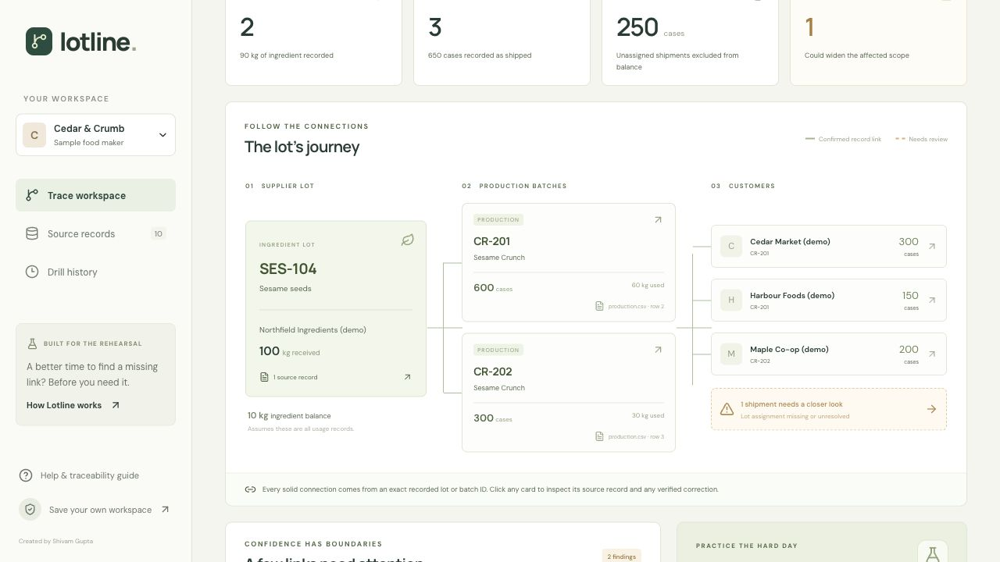

# Lotline

**Find the lot. Follow the records. See what is missing.**

Lotline is a recall-rehearsal workspace for small packaged-food manufacturers using spreadsheets. Connect receiving, production and shipment CSVs; inspect a supplier lot's recorded path to finished batches and customers; preserve unresolved records alongside the result.

Created by **Shivam Gupta** for Build North 2026, with substantial Codex assistance. The application began from a Vinext starter. This is a working build for synthetic demonstrations and evaluation, with explicit production-readiness gates rather than a compliance guarantee.

## The two-minute tour

1. Open **Trace workspace**. The synthetic Cedar & Crumb sample is preloaded; no account is needed to explore it.
2. Trace sesame lot **SES-104**. Its 100 kg receipt connects to batches **CR-201** and **CR-202**: 90 kg recorded ingredient use, 900 cases produced, 650 cases shipped to three customers, and a 250-case calculated balance.
3. Open a lineage card to inspect the original filename and row reference. CSV imports preserve mapped and unmapped source cells separately from normalized values and reviewed corrections.
4. Inspect the separate **40-case shipment with no batch assignment**. It remains unresolved; it is not silently included in or excluded from the confirmed 650 cases.
5. Choose **Export trace** for CSV, complete evidence JSON, or a print-ready report saved as PDF through the browser.
6. Sign in to save a private workspace and record an immutable rehearsal snapshot under **Drill history**.

All sample companies and records are fictional. The original sample has 2 receiving records, 3 production records and 5 shipments. Its 10 kg ingredient balance and 250-case finished-product balance are arithmetic from recorded movements, not physical counts.

## Run locally

Requires Node.js **22.13 or later**; the test suite was executed with Node **22.16.0**. A clean clone defaults to the portable execution profile.

```sh
npm run install:ci
npm run build
node --import ./scripts/sites-env.mjs ./node_modules/wrangler/bin/wrangler.js d1 execute DB --local --config dist/server/wrangler.json --persist-to .wrangler/state --file drizzle/0000_brave_the_watchers.sql
node --import ./scripts/sites-env.mjs ./node_modules/wrangler/bin/wrangler.js d1 execute DB --local --config dist/server/wrangler.json --persist-to .wrangler/state --file drizzle/0001_steady_captain_britain.sql
npm run dev
```

Apply these migrations once to a fresh local database, in order. Do not replay already-applied migrations. Open the loopback URL printed by the dev server, normally `http://localhost:5173`. The sample works without a database; private save/history needs migrated D1 storage. Local files and database state are ignored by Git.

Portable development simulates sign-in at `/signin-with-chatgpt?return_to=/` with the starter's test identity. This is a local development convenience, not production authentication. `npm start` previews the built Worker locally and does not simulate sign-in or deploy anything. Hosted Sites authentication is platform-owned. Additional inherited runtime details are retained in [starter-runtime.md](docs/starter-runtime.md).

## Verify

```sh
node --experimental-strip-types --test tests/trace.test.ts
node --test tests/api.test.mjs
node --test tests/api-worker.test.mjs
npx tsc --noEmit
npm run build
```

The 24 engine/import tests, 15 API tests and 2 Worker integration tests passed: **41 tests total**. TypeScript checking and the production build also passed. API tests execute actual handlers against SQLite with injected platform identity and D1 adapters. They cover authorization, cross-origin rejection, input limits, revision conflicts, snapshots, quotas and model-output validation. AI responses are mocked; no live Anthropic call is claimed. Separate production browser checks verified ChatGPT sign-in, D1 workspace save/reopen, a saved multiline-note drill, downloaded snapshot JSON, CSV import and the mobile layout. Two genuine-account browser isolation has not been tested; injected-identity isolation tests pass. See [verification evidence](docs/verification.md) for scope and limits.

## Architecture

- React 19, TypeScript, Tailwind and Vinext/Vite for the interface and Worker runtime.
- Pure deterministic lineage engine in `lib/trace.ts`; CSV parser/mapping in `lib/import.ts`.
- Sites-provided ChatGPT identity; server-scoped workspace ownership.
- Cloudflare D1 with versioned workspace data, database-generated activity events and immutable drill snapshots.
- Optional server-side Anthropic column-mapping suggestions. No key is required for rule-based mapping or deterministic trace computation.

Optional Worker secret: `ANTHROPIC_API_KEY`. Optional setting: `ANTHROPIC_MODEL` (default `claude-haiku-4-5-20251001`). Configure secrets through your hosting environment; never expose them in browser variables or commit them. **Suggest mapping** sends headers and up to three sample rows after an explicit user action; when configured these go to Anthropic. A missing key, provider error, timeout, invalid output or quota limit yields an honestly labeled rules fallback. The selected deployment uses the rule-based fallback; no live provider key is needed or claimed.

Storage is capped at 25 MiB per user across workspace dataset and snapshot payloads, in addition to row/request/workspace limits. A public [privacy notice](https://lotline-recall.sg127977958.chatgpt.site/privacy) describes data handling and remaining hosting limitations.

See [architecture](docs/architecture.md), [operator guide](docs/operator-guide.md), [security](SECURITY.md), [commercial thesis](docs/business.md), and [launch checklist](docs/launch-checklist.md).

## Boundaries

The supported model is one transformation: **ingredient lot → finished batch → shipment**. Rework, intermediates, returns, waste and unrecorded stock adjustments need additional records and review. Use unique supplier lot IDs across the workspace; lot-code collisions across suppliers are not separately namespaced. Do not combine incompatible units. A smaller confirmed list is not proof that other goods were unaffected.

Lotline does not decide food safety, recall necessity or legal compliance. Before operational customer use, validate data completeness, practitioner suitability, data residency, retention/deletion, backups/recovery and hosting controls. No customer traction or paid usage is claimed.

## Project publication

[Public repository](https://github.com/shi1720/lotline) · [Live application](https://lotline-recall.sg127977958.chatgpt.site)

The public application and repository have been verified accessible. GitHub Actions passed the clean install, typecheck, all 41 tests, production dependency audit and build for functionality release `8697e0c`. The current release manifest records the exact deployed source revision. Video recording and Devpost submission remain separate steps. Official eligibility requires Canadian residence; see the launch checklist for registration and Toronto attendance gates.

## License and attribution

Lotline-authored code is MIT licensed, copyright 2026 Shivam Gupta. Retain third-party notices, including `build/sites-vite-plugin.LICENSE` and `vendor/shadcn-tailwind-4.13.0.LICENSE.md`. Dependencies retain their own licenses. The MIT license does not replace those notices.

## Product view



The screenshot shows synthetic supplier, batch and customer records. The dashed shipment remains unresolved.
