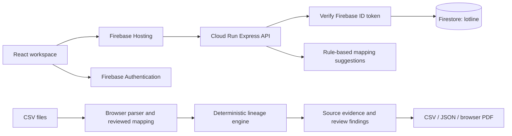

# Lotline architecture

## Production path

The public frontend is [lotline-trace.web.app](https://lotline-trace.web.app). Firebase Hosting serves the Vite/React static assets and rewrites `/api/**` to an Express service on Cloud Run in us-central1. Firebase Authentication provides email/password accounts. The API validates bearer ID tokens using the Firebase Admin SDK, including revocation checking, and derives the owner from the verified UID.

The named Firestore database is `lotline` in `northamerica-northeast1`, Montreal. The API runs in us-central1. This architecture has cross-region processing; Montreal storage is not a guarantee of exclusively Canadian processing or a legal suitability determination.

## Implementation map

| File | Responsibility |
|---|---|
| `app/lotline.tsx` | Trace, records, review, evidence, history and exports |
| `lib/firebase-client.ts` | Firebase account/session operations and token retrieval |
| `vite.firebase.config.ts` | Active frontend build and local API proxy |
| `server/index.ts` | Cloud Run entry point, Admin SDK and named database |
| `server/app.ts` | Protected Express API, transactions, limits and error responses |
| `lib/server-validation.ts` | Strict shared dataset and request validation |
| `lib/trace.ts` | Deterministic traversal, quantity calculations and findings |
| `lib/import.ts` | CSV parser, canonical mappings and imported rows |
| `lib/demo.ts` | Fictional Cedar & Crumb records |
| `tests/trace.test.ts` | Domain/import and adversarial evidence cases |
| `tests/firebase-api.test.mjs` | Current API behavior tests |

Older `app/api` handlers, Cloudflare D1 schema and Sites runtime files document the earlier deployment. They are not the current Firebase serving path. Their tests remain useful regression context and do not establish Firebase runtime correctness by themselves.

## Trace semantics

A receipt identifies ingredient, supplier, lot, received date and quantity/unit. A production row links a consumed ingredient lot to a finished batch, recording output once per consistent batch. A shipment identifies a finished batch, product, customer, shipped date and quantity/unit. Lot and batch identifiers are case-sensitive, with surrounding whitespace removed. Descriptive names and recognized unit aliases are normalized separately.

Only explicit identifiers establish confirmed links. The engine keeps uncertain shipment records separate. Duplicate/invalid records, missing identities, supplier-local lot collisions, incompatible units, contradictory quantities and impossible linked dates produce findings. Production before every recorded lot receipt and shipment before production block readiness and quantity assurance. Same-day evidence is permitted because dates do not establish time of day. This is not a cumulative inventory ledger.

The synthetic SES-104 fixture has 100 kg received, 90 kg recorded ingredient use, two batches producing 900 cases, 650 confirmed shipped cases to three customers and a 250-case calculated balance. A separate forty-case shipment lacks a batch assignment and stays in review scope. Kilograms are never converted into finished cases.

CSV rows retain ID, filename and physical start-row number. `sourceData` retains all mapped and unmapped original cells, including whitespace and multiline content, with line endings normalized to LF. A corrected shipment retains `originalBatch`, a nonempty `correctionNote` and `correctedAt`. Evidence separates original cells from current values.

## Data and concurrency

Data is scoped below `users/{verifiedUid}/workspaces/{workspaceId}`. Each workspace stores its dataset, revision, name, timestamps, application-counted storage bytes and counts. Activity records and drills are subcollections. Account documents track total payload bytes and workspace count.

Firestore transactions enforce revision checks, account limits and related bookkeeping. Stale saves return 409 instead of overwriting a newer revision. A drill is computed server-side from the saved dataset; it stores the dataset, result, source revision, selected lot and reviewer notes. Payloads are chunked below Firestore document-size limits. Later workspace edits do not rewrite the earlier drill. These are application snapshots, not independently notarized evidence or an external immutable audit service.

Limits in the current API:

| Limit | Value |
|---|---:|
| JSON request | 1 MiB |
| Serialized workspace dataset | 700,000 bytes |
| Total records per workspace | 5,000 |
| Workspaces per account | 20 |
| Rehearsals per workspace | 100 |
| Snapshot payload | 1,800,000 bytes |
| Application-counted saved payload per account | 25 MiB |
| Workspace activity history | 5,000 events |

Application accounting is not a Firestore billing-byte measurement. Deletes remove accessible workspace data and dependent records; provider logs, backups and Firebase Authentication account deletion have separate lifecycles. Validate those policies before operational use.

## Trust boundaries

Private endpoints require Firebase bearer tokens. The API constructs user-scoped document paths rather than trusting a client owner field. Browser access to Firestore is not needed for saved workspaces; the server owns persistence. Mutation requests require an allowed Origin and JSON content type where applicable, with streamed/body limits and shared schemas. Private responses disable caching. Production allowed origins must be explicitly configured.

The public sample requires no account. Unsaved work exists in browser memory and can be exported. Firebase Auth manages the account session; a signed-in session is not permission to access another UID's data. Genuine-account hosted isolation needs a live test in addition to mocked/injected authorization tests.

The API also applies per-process, per-UID throttles of 120 requests and 30 writes per minute, returning 429 and Retry-After when exceeded. These counters are not distributed; database storage quotas remain transaction-backed. Deletion uses a persistent intent and bounded retries so a partially deleted workspace can be retried without decrementing account quota twice. A 503 means deletion needs retry rather than confirmation of complete removal.

## Mapping and models

The Firebase `/api/map` endpoint returns reviewed rule-based header suggestions. It does not call a live model and never changes source values. The legacy optional Anthropic implementation is not the active production feature. No provider secret is needed for the current deployment, and no live LLM inference is claimed.

## Operational limits

The model supports one ingredient-to-finished-batch layer. It does not reconstruct rework, intermediate production, returns, disposal, cross-contact or unrecorded transfers. Calculated stock is recorded output less recorded shipments. Trace results describe uploaded evidence, not food safety or complete incident scope. See [verification](verification.md) for checks actually executed on the current release.
