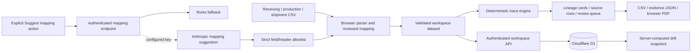

# Lotline architecture

## Design objective

Turn structured manufacturing records into a reproducible, inspectable rehearsal. Keep uncertain associations separate from confirmed record links. AI may suggest file-column mappings; it does not determine incident scope or create product lineage.

## Source map

| Surface | Responsibility |
|---|---|
| `app/lotline.tsx` | Trace workspace, Source records, review queue, Drill history, evidence modal and exports |
| `lib/trace.ts` | Pure record-based traversal, quantity calculations and findings |
| `lib/import.ts` | CSV parsing, canonical column mappings and row conversion |
| `lib/demo.ts` | Synthetic Cedar & Crumb fixture |
| `lib/server-validation.ts` | Strict request and dataset schemas |
| `lib/server-http.ts` | Identity, ownership lookup, JSON limits and mutation-origin boundary |
| `app/api/workspaces/` | Workspace CRUD, activity and rehearsal snapshots |
| `app/api/map/route.ts` | Optional provider request, output validation, quota and fallback |
| `db/schema.ts`, `drizzle/` | Persistent schema and ordered migrations |
| `tests/trace.test.ts`, `tests/api.test.mjs` | Domain/import cases and real-handler SQLite tests |

## Data model and trace semantics

A receipt captures ingredient, supplier lot, supplier, date, quantity/unit and source coordinates. A production row consumes an ingredient lot into a named finished batch and records batch output in its own quantity/unit. A shipment references a finished batch, product, customer, date and quantity/unit. Each row retains an ID, filename and source-row number. CSV-imported rows retain optional sourceData with every mapped and unmapped header/cell; original whitespace and multiline content are retained, with CRLF/CR normalized to LF. Evidence shows Original CSV row separately from normalized/current fields and corrections. A manually corrected shipment also retains originalBatch, a required nonempty correctionNote and an ISO correctedAt timestamp; the interface and exports distinguish the correction from the original assignment.

For SES-104 the sample has 100 kg received; 60 kg feeds CR-201 and 30 kg feeds CR-202. Those batches produce 600 and 300 cases respectively. Three confirmed customer shipment rows account for 650 cases, leaving a calculated 250-case balance. One 40-case Sesame Crunch shipment has no batch and stays in review scope. SES-105 and its CR-203 batch provide an unrelated comparison. Totals never convert ingredient kilograms into cases.

Only exact recorded lot/batch relationships establish confirmed links. Duplicate/invalid rows, missing assignments, contradictory quantities, unmatched evidence and incompatible units produce findings. The trace cannot infer unrecorded movements. The supported model is one transformation layer; rework, blended intermediate production, returns and waste are not a full inventory ledger. Use unique lot IDs across the workspace; identical supplier lot codes should be normalized to distinct IDs before import.

## Persistence and concurrency

`workspaces` stores the current dataset JSON, owner ID, name, timestamps and revision. `events` stores database-generated system activity and clearly typed user notes. `drills` stores the selected lot, reviewer notes, full record-set snapshot, computed result and source revision. `ai_usage` stores expiring quota counters keyed by a hash-derived user/window identifier.

Workspace edits use revision compare-and-swap; stale updates return 409 instead of silently overwriting another save. Snapshot creation computes its result server-side from saved data; later workspace changes do not alter previous snapshots. Database triggers generate system events for create/update/drill operations. These are application activity records, not independently notarized evidence or an immutable external audit service.

Aggregate saved payload storage is capped at 25 MiB per user, counting workspace dataset JSON and saved snapshot dataset/result/notes as UTF-8 bytes. Atomic SQL predicates enforce the limit on creation, updates and snapshots; updates subtract the prior dataset size so shrinking or equal-size changes remain allowed at quota. Deletion remains available and frees dependent payload bytes. Tests cover multibyte data, quota exhaustion, tenant separation and shrink/equal-size behavior.

The account limit is 20 saved workspaces; each workspace supports 5,000 total rows and 100 drill snapshots. The JSON body limit may be reached before the row limit. The UI limits CSV/backup files to 1,000,000 bytes. Workspace deletion cascades to its activity and drills. Hosting backup retention remains a separate production concern.

## Identity and trust boundaries

Hosted authentication belongs to Sites. The application uses the injected stable authenticated user ID and checks ownership on every protected resource. It does not trust a client-supplied owner field. Deployment must preserve that platform boundary: do not expose the Worker through an alternate route that accepts spoofed identity headers from arbitrary callers.

Portable development provides a local test identity, restricted by the starter's development integration. It is not included as a production login solution. The standalone built preview does not simulate sign-in.

Mutation handlers check Origin/Sec-Fetch-Site, JSON content type, streamed body size and schemas. Private API responses disable caching. See SECURITY.md for verified controls and remaining operational gates.

## Optional AI behavior

Only a signed-in user's explicit **Suggest mapping** action invokes `/api/map`. Headers and up to three sample rows are supplied, capped by the schema. A configured `ANTHROPIC_API_KEY` enables Anthropic; `ANTHROPIC_MODEL` overrides the default model. The model receives untrusted source text as data and is asked only to select existing headers for canonical fields.

Strict response shape, canonical-field completeness, known-header checks and duplicate-header rejection constrain accepted output. Timeouts, invalid JSON, provider errors and exhausted quotas return rule-based mappings with a truthful explanation. The feature has a 15-second request timeout and 6/minute + 100/day per-user durable limits. These constraints were exercised with mocked provider responses; a live provider call remains unverified.

## Test evidence and deployment status

The current passing suite comprises 24 engine/import tests, 15 API tests and 2 Worker integration tests (41 total). TypeScript checking and production build pass. The Node API suite uses actual route handlers, in-memory SQLite and injected D1/identity adapters; separate Worker tests cover the Worker boundary. Browser and production HTTP checks are listed independently in verification.md. The API identity adapter tests do not constitute two genuine-account hosted browser isolation. No live Anthropic call is claimed.

The [public repository](https://github.com/shi1720/lotline) and [live application](https://lotline-recall.sg127977958.chatgpt.site) are accessible. Production browser checks verified hosted sign-in, D1 save/reopen, snapshot save/download, CSV import and responsive mobile layout. The first verified deployment corresponds to `0a95369`; follow-up source changes require redeployment. See verification.md for exact boundaries. Follow docs/launch-checklist.md before treating the service as ready for actual customer records.
